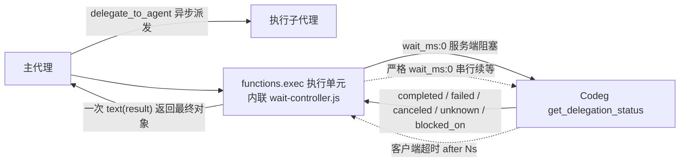

# smart-dispatch

面向 Codeg 多智能体工作台的**分工技能包**：主代理负责规划、技术决策与验收，把具体执行委托给用户每次明确指定的执行代理；附带一个可内联到宿主执行单元的**阻塞等待控制器**，用于处理 Codeg 等待工具在客户端固定超时后仍需继续等待的情况。

> 本仓库只是一个技能包与一份普通 JS 源码，不是 MCP 服务，也不是可独立运行的代理程序。

---

## 0. 一分钟概览

| 项目 | 内容 |
| --- | --- |
| 仓库 | `https://github.com/ana52070/smart-dispatch` |
| 技能目录 | `skills/smart-dispatch/` |
| 组成部分 | `SKILL.md` + 2 份参考文档 + 1 份控制器源码 + 57 项控制器测试 |
| 控制器依赖 | 无第三方 JS 库；需要 Codeg MCP 与已验证的宿主执行入口 |
| Node 版本 | `>= 22`（仓库 CI 覆盖 22 / 24） |
| 发布渠道 | 仅 GitHub 仓库；不发布到 npm |

```text
smart-dispatch/
├── README.md
├── package.json                # private:true，只有测试脚本
├── .gitignore
├── .github/workflows/test.yml  # Node 22/24 × ubuntu/windows，直接 npm test
├── scripts/install.mjs         # 可选的小安装脚本（备份后覆盖）
└── skills/smart-dispatch/
    ├── SKILL.md                              # 技能主体：分工/规划/等待/验收
    ├── references/wait-controller.md         # 控制器使用说明（内联模板）
    ├── references/wait-controller-compatibility.md  # 一次本地验证的匿名摘要
    ├── scripts/wait-controller.js            # 纯 JS 控制器核心（无依赖）
    └── tests/wait-controller.test.mjs        # 57 项测试
```

---

## 1. smart-dispatch 做什么

- **主代理**：理解需求、检查证据、做规划与关键设计、解决疑难、决定任务书、审查差异、最终验收。
- **执行代理**：代码探索、具体实现、跑测试、自检、按反馈返修。
- **执行代理由用户每次指定**。技能不固定代理名称、不按名称猜测模型或额度、不擅自换用未被指定的代理。用户尚未指定时，主代理先做只读分析和需求梳理，在**首次委托前**通过可用提问工具确认执行代理。
- 分工通过 **Codeg MCP 的 `delegate_to_agent`** 完成，遵循宿主提供的权威路由；不在 Codeg 场景下用原生子代理工具顶替用户指定的 Codeg 代理。

调用方式取决于各宿主自己的技能发现机制：

| 宿主 | 调用形式（示例） |
| --- | --- |
| Codex | `$smart-dispatch` |
| Claude Code / Antigravity / CodeBuddy | `/smart-dispatch` |

> **重要**：上表只是按各宿主常见的技能触发写法给出示例。**把文件复制到技能目录并不保证宿主一定能发现或正确调用**，也不构成运行验证。安装后请用宿主自己的技能列表或调用方式实测确认；发现失败时按宿主文档排查目录约定与重载方式，不要假定本仓库已经替宿主完成注册。

### 与等待控制器的关系

控制器解决的是「等待链路」问题，不改变分工原则：

- 它**不派发**、**不恢复**、**不取消**子任务；
- 它不新增 MCP 服务，不读取令牌、socket 或进程参数；
- 它只是把「一次 `get_delegation_status` 调用被客户端超时打断」变成「在同一执行单元内继续等待同一批任务」，直到拿到可操作结果。

---

## 2. 等待控制器：它是什么、不是什么



### 2.1 它是可内联的普通 JS，不是独立服务

- `skills/smart-dispatch/scripts/wait-controller.js` 是**纯 JS、零依赖**源码文件，把整份内容粘贴进宿主的执行单元（Codex 下是 `functions.exec` / Code Mode 单元）后即可调用 `waitUntilActionable({ taskIds, callStatus, now })`。
- **不能用 `node scripts/wait-controller.js` 直接运行来获得任何工具**。普通 Node 子进程没有 `tools` 对象，也拿不到当前会话已授权的 MCP 工具；直接运行既不会等待，也不会有外层分段恢复能力。
- 不注册新 MCP 服务，不建立新认证通道，不读写凭证。
- 内联模板里的 `callStatus` 绑定必须指向当前会话**实际发现**的等待工具名（各宿主命名空间不同，可能形如 `codeg-mcp/get_delegation_status`），**不要硬编码或凭记忆猜测**。

### 2.2 已验证路径与未验证路径

| 情形 | 行为 |
| --- | --- |
| Codex `functions.exec` + `functions.wait` + Codeg 等待工具（本次已测） | **已验证，门禁满足时默认启用**控制器，自动串行续等 |
| 其他主宿主（Claude Code / Antigravity / CodeBuddy 等） | 技能文件可按同一布局安装，但等效执行入口**尚未验证**；沿用 `SKILL.md` 原有的阻塞等待与**有限恢复**规则，不套用控制器模板，不猜测执行入口 |
| 上述代理作为**执行子代理** | 不需要具备 Code Mode；主会话是已验证 Codex 时照常委托并等待，作为子代理不影响 Codex 主会话使用控制器 |

门禁满足即启用，不再每次询问；用户明确要求不使用控制器时，以用户指令为准。

---

## 3. 等待语义与返回内容（准确边界）

### 3.1 一次显式无限等待

主代理调用：

```text
get_delegation_status(task_ids: [...], wait_ms: 0)
```

- `wait_ms: 0` 表示**服务端无限等待**，直到任一任务进入可操作状态，而不是「立刻返回」。
- 省略 `wait_ms` 才是立即查询。控制器**从不用**省略形式，也不会改成 `wait_ms=60000` 之类的固定时长循环。
- 每次调用参数严格为 `{ task_ids: taskIds, wait_ms: 0 }`，**串行**执行，不并发叠加。

### 3.2 自动续等的是「已确认的客户端超时」

控制器只对**可确认的传输超时诊断**自动续等，例如：

```text
tool call error: tool call failed for `codeg-mcp/get_delegation_status`

Caused by:
    timed out awaiting tools/call after 300s
```

- 必须整体匹配该诊断形状（含时长单位），**正文里偶然出现 `timeout` 字样不算**；子任务结果正文里的超时字符串永远不会触发续等。
- 正常耗时（接近报错时长）的超时可继续，不设总次数上限；连续**几乎立即返回**的超时最多 2 次后熔断交接，防止过期连接忙循环。
- 其余错误一律**不重试**：认证失败、连接断开、参数错误、未知异常分别返回诊断并交主代理决策。

### 3.3 能返回的状态

| 返回 | 含义 |
| --- | --- |
| `completed` / `failed` / `canceled` | 终态，处理并移出等待集合 |
| `unknown` | 明确交接，不猜测 |
| `running` + `blocked_on` | 子任务在等人工处理，保留 `kind` / `request_id` / `title` 交给主代理 |
| `running`（无 `blocked_on`）且 `wait_ms=0` 已返回 | 视为 `protocol_anomaly`，**拒绝轮询**，交主代理检查工具语义 |

`kind` 还可能是 `transport_error`、`malformed_response`、`timeout_exhausted`、`invalid_input`，这些都需主代理决策，控制器不自行重试。

### 3.4 明显不做的四件事

1. **不无限吞未知错误**：非超时错误立即返回证据。
2. **不重新派发**：控制器不调用 `delegate_to_agent` / `resume_delegation` / `cancel_delegation`。
3. **停止等待 ≠ 取消子任务**：用户只是不想等了，子任务仍在跑；取消必须由主代理另行决定。
4. **不承诺零成本**：外层 `functions.exec` / `functions.wait` 恢复**同一执行单元**时仍可能唤起模型、消耗 token。`wait_ms=0` 只是服务端无限等待，客户端与执行宿主的时限依然存在，**不保证永久零超时**，也不保证「完全后台回调」。

权限层面同样明确：**实际权限、审批与凭证输入仍由用户处理**，控制器只是及时把 `blocked_on` 交回主代理，不能绕过平台强制确认。

---

## 4. 并发模型：多会话独立，多子任务批量

- **每个主会话独立**：不同主会话各自持有自己的任务、控制器和执行单元，没有全局单例、没有全局等待锁。工具名相同不代表状态共享；Codeg 按父连接鉴别任务归属。
- **同一主代理的多个子任务**：把这些任务的真实 ID **一次性**传进同一个 `task_ids` 批次，用一个等待；不要为每个子代理各开一个控制器。
- **任一可操作即返回**：批次返回后处理终态项、移出集合，再对剩余 ID 发起下一次等待（新执行单元、新控制器调用、ID 集合已缩减）。
- **禁止重叠等待**：同一任务不得同时存在两个等待；同一任务集合已有未完成执行单元时，先恢复那个单元，不新建第二个 `get_delegation_status`。
- 同一主代理对三个子任务的分批等待与「完成后移除 ID」有测试覆盖；**多真实主会话的整机压力测试尚未进行**，不承诺任意并发量、无排队或绝无缺陷。

---

## 5. 验证：做了什么、没做什么

以下数字来自**一次本地验证**，原始日志、会话编号、任务 UUID、机器指纹与安装路径不随本仓库分发。

### 5.1 可以复现的部分

```bash
git clone https://github.com/ana52070/smart-dispatch.git
cd smart-dispatch
npm test                      # 57 项控制器测试 + 3 项安装脚本测试
npm run test:syntax           # node --check 控制器核心
```

- Node `>= 22`，无 `npm install` 步骤（仓库无第三方依赖，无锁文件）。
- 仓库 CI 在 Node 22 / 24 × ubuntu / windows 上跑同一条 `npm test`。
- 测试通过 `vm` 加载**同一份**生产源码 `scripts/wait-controller.js`，不复制实现。

### 5.2 控制器测试

- **57 项全部通过**，其中包含 **24 个控制器逻辑实例并发**运行，验证任务 ID、重试计数、时钟互不串扰。
- 同时覆盖：结构化解包优先级、合法子任务正文里的超时短语不误判、正常耗时超时无限续等、快重复熔断、三种 `blocked_on`、混合批次、无效输入（不发起任何工具调用）、无 `console` 环境下的文档化调用方式。

### 5.3 真实长等待（真实委托，非模拟）

- 子代理侧**真实睡眠 650.0 秒**（单调时钟测量）。
- 控制器在同一执行单元**累计等待 1043.053 秒**；差值来自子代理启动阶段先修正自身命令引号导致的启动延迟，**不能把全部时间计为睡眠时间**。
- **3 次约 300 秒的客户端超时被自动续等，第 4 次成功收取 `completed`**；全程未重新派发，未改成定时查询。
- 起始阶段的真实权限阻塞被及时返回；平台强制授权仍由用户处理。

### 5.4 真实超时与连接释放（隔离管道）

- 同一 Codex 客户端（0.165）与已安装的 `codeg-mcp`，在私有测试命名管道上把工具超时设为 **1 秒并连续查询两次**：观察到两个真实 `after 1000ms` 错误与两个取消通知，通知 ID 与请求 ID 匹配。
- **最大同时查询连接 1，结束后剩余 0**；管道在取消通知后约 0.272 毫秒关闭，且发生在客户端进程退出之前，因此释放不是进程退出造成的。
- 显式 `notifications/cancelled` 用例中，查询管道在测试进程退出前关闭，约 0.119 毫秒。

### 5.5 证据边界（请勿混用）

- **真实长等待证据**与**隔离管道释放证据是两套独立证据**，不能合并、也不能当作对生产 broker 内部计数（存活等待数、连接持有、堆内存）的直接采样。
- **本地源码后端**另有 8 项批量 / 父会话隔离测试与 1 项「对端关闭时结束等待」测试通过；这些来自 **0.41.3 开发基线**的测试二进制。
- 真实长测使用的桌面应用是**生产 0.42.1**。两套版本必须区分表述：本地测试通过 ≠ 生产 0.42.1 进程内状态已采样。
- 一次与长等待并行的参数错误诊断调用约 128 秒后才返回，排队发生在哪一层**尚未定位**；不能据此断言旧查询泄漏，也不能保证所有并行调用无延迟。
- **这不是整机多真实会话压力测试**；应用异常退出、外层强制终止后的清理边界仍然**未知并保留**。

---

## 6. 安装

### 6.1 推荐技能目录

| 宿主 | 目标路径 |
| --- | --- |
| Codex | `~/.codex/skills/smart-dispatch` |
| Claude Code | `~/.claude/skills/smart-dispatch` |
| Antigravity CLI | `~/.gemini/config/skills/smart-dispatch` ← **CLI 路径；不是 IDE 的扩展/插件目录** |
| CodeBuddy | `~/.codebuddy/skills/smart-dispatch` |

仓库内的源目录是 `skills/smart-dispatch`，安装时把**该目录的内容**放到上表路径（即目标下直接有 `SKILL.md`）。

### 6.2 手动复制

PowerShell：

```powershell
$src = ".\skills\smart-dispatch"
$dst = Join-Path $HOME ".codex\skills\smart-dispatch"
if (Test-Path $dst) {
  $bak = Join-Path $HOME (".smart-dispatch-backups\{0}\codex" -f (Get-Date -Format "yyyyMMdd-HHmmss"))
  New-Item -ItemType Directory -Force -Path (Split-Path $bak) | Out-Null
  Copy-Item -Recurse -Force $dst $bak          # 覆盖前备份旧技能
}
New-Item -ItemType Directory -Force -Path $dst | Out-Null
Copy-Item -Path (Join-Path $src "*") -Destination $dst -Recurse -Force
```

POSIX shell：

```sh
# 换成上表对应路径，例如 Codex：
dst="$HOME/.codex/skills/smart-dispatch"
src="./skills/smart-dispatch"
if [ -e "$dst" ]; then
  bak="$HOME/.smart-dispatch-backups/$(date +%Y%m%d-%H%M%S)/codex"   # 宿主名可改
  mkdir -p "$(dirname "$bak")"
  cp -R "$dst" "$bak"                            # 覆盖前备份旧技能
fi
mkdir -p "$dst"
cp -R "$src/." "$dst/"
```

> 覆盖前一定先备份旧技能目录。

### 6.3 可选：小安装脚本

仓库根目录的 `scripts/install.mjs` 只是把上面的复制动作包装成可审阅脚本，默认**只打印计划**，必须 `--yes` 才写入，目标已存在时先备份到 `~/.smart-dispatch-backups/<时间戳>/<宿主>/`。

```bash
node scripts/install.mjs list
node scripts/install.mjs plan  --target codex
node scripts/install.mjs apply --target codex --yes
node scripts/install.mjs apply --all --yes          # codex / claude / antigravity / codebuddy
```

默认安装到系统用户目录；需要自定义目录或隔离测试时，显式传入 `--home-root <目录>`，不要依赖修改 `HOME` 来隔离 Windows 测试。覆盖前备份旧技能，然后更新匹配文件，保留目标目录中额外的用户文件。

它不写任何宿主配置、不联网、不修改控制器功能。**技能文件就位不等于宿主已识别**，安装后仍需用宿主自己的方式确认技能被发现。

---

## 7. 使用要点

1. 主代理先读源码/证据，再定方案与验收标准；任务书独立可理解，含绝对工作目录、可改范围、验收标准与返回格式。
2. `delegate_to_agent` 异步派发后**记录真实任务 ID**；有独立工作就继续做，没有就阻塞等待。
3. 需要等待时，按 `references/wait-controller.md` 把核心源码**完整内联**到执行单元，绑定真实工具名，一次传入全部待处理 ID。
4. 收到 `blocked_on` 就处理阻塞，不反复空等；收到终态就移出集合并继续等剩余任务。
5. 主代理验收看**实际差异与真实命令输出**，不凭「已完成」结论放行。返修给出具体位置、期望行为与验收标准。
6. 两轮基于新证据的不同方法仍失败，就带错误原文片段、已尝试方法、当前改动交回主代理，不无限重派。

更多规则细节见 `skills/smart-dispatch/SKILL.md`，控制器实操模板见 `skills/smart-dispatch/references/wait-controller.md`。

---

## 8. 已知限制

- 只有 Codex 主宿主路径经过真实长等待验证；其他主宿主入口未验证，不能把「文件已同步」当作「已支持」。
- 服务端无限等待不等于客户端无限等待；客户端、执行宿主、平台审批都可能打断等待。
- 控制器不能绕过权限与审批，也不处理凭证输入。
- 应用退出、强制终止、超时边界附近的提问去重、多真实主会话高并发等边界仍未做完整压力验证。
- 真实耗时与失败次数受网络、代理额度、宿主版本影响，本仓库不承诺固定的节省比例或「一定能等到结果」。

---

## 9. 开发与测试

```bash
npm test                                  # 57 项控制器测试 + 3 项安装脚本测试
npm run test:syntax                       # 语法检查
node --check skills/smart-dispatch/scripts/wait-controller.js
```

CI：`.github/workflows/test.yml`，Node 22 / 24，ubuntu-latest / windows-latest，直接 `npm test`（无 `npm install`、无缓存、无锁文件依赖）。

## 10. 许可证

本仓库暂未设置许可证。
