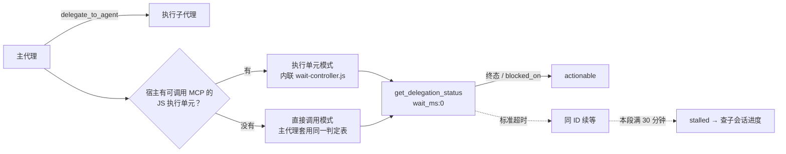

# smart-dispatch

面向 Codeg 多智能体工作台的**分工技能包**：主代理负责规划、技术决策与验收，把具体执行委托给用户每次指定的执行代理；附带一个与宿主无关的**等待控制器**，让主代理在等待子代理时不轮询、少唤起，并能自己识别和处理卡死的子任务。

> 本仓库只是一个技能包和一份普通 JS 源码，不是 MCP 服务，也不是可以独立运行的代理程序。

## 0. 概览

| 项目 | 内容 |
| --- | --- |
| 版本 | 1.3.0（`package.json`、`SKILL.md`、控制器 `WC_VERSION` 三处一致，有测试保证） |
| 技能目录 | `skills/smart-dispatch/` |
| 控制器依赖 | 无第三方库；需要 Codeg MCP |
| Node 版本 | `>= 22`，仅用于运行测试和安装脚本（CI 覆盖 22 / 24 × ubuntu / windows） |
| 许可证 | Apache-2.0 |

```text
smart-dispatch/
├── README.md
├── LICENSE
├── package.json                 # private:true，只有测试脚本
├── .github/workflows/test.yml
├── scripts/install.mjs          # 可选安装脚本：默认只打印计划，写入前先备份
├── tests/install.test.mjs
├── eval/                        # 协作效果评测：题目、隐藏测试、评分与 token 统计
└── skills/smart-dispatch/
    ├── SKILL.md                         # 核心规则：分工、委托判据、任务书、问题协议、验收
    ├── references/
    │   ├── brief-template.md            # 任务书骨架 + 场景检查清单
    │   ├── eval-report.md               # 协作效果实测结论（委托收益判据的依据）
    │   ├── waiting.md                   # 等待判定表、停滞处理、断联与缓存丢失恢复
    │   ├── wait-controller.md           # 执行单元模式：适配契约与调用模板
    │   └── wait-controller-compatibility.md  # 各宿主实测记录（唯一的证据来源）
    ├── scripts/wait-controller.js       # 纯 JS 决策核心 + 自动循环
    └── tests/wait-controller.test.mjs   # 开发测试，不会被安装
```

## 1. 它做什么

- **主代理**：理解需求、检查证据、规划、关键设计、解决疑难、写任务书、审查差异、最终验收。
- **执行代理**：由用户每次指定，负责代码探索、实现、测试、自检和返修。
- **委托收益判据**：先比较“讲清楚”与“做出来”的成本，执行量明显大于说明量时才委托；规格密、代码短的任务主代理自己做。
- **质量保持**：验收先行（用例表 + 不给执行代理看的保留用例）、需求原文不转述、主代理独立验收，两轮返修不过就亲自接管。
- **问题协议**：子代理的问题一律交回主代理；主代理自己能判断的就自己判断，只把真正属于用户的决定汇总后再问用户。

调用方式取决于各宿主自己的技能发现机制，例如 Codex 用 `$smart-dispatch`，Claude Code、Antigravity、CodeBuddy 用 `/smart-dispatch`。文件复制到技能目录后，请用宿主自己的技能列表确认能被发现。

## 2. 等待：一套语义，两种模式



- **决策核心** `wcDecide` 是纯函数：输入一次等待调用的结果，输出“再调一次”或“返回结果”。执行单元模式由 `waitUntilActionable` 自动循环；直接调用模式由主代理按 `references/waiting.md` 的判定表执行。两者语义一致，同一套测试覆盖。
- **只用 `wait_ms:0`**：服务端无限等待。只对整句匹配的标准客户端超时续等；连续两次几乎立即返回的超时视为链路异常，熔断交接。
- **每段都有上限**：默认 30 分钟后返回 `stalled`。主代理只读查一次子会话进度：有进展就静默续等；连续两段没有进展，就判定卡死，取消后重派一次；重派后仍卡死，才去问用户。
- **断联与缓存丢失**：等待调用被中断时，用原任务 ID 续等，不重派。broker 丢失任务缓存时，改以子会话为准，只设一次有依据的定时唤醒，不做短间隔查询。

控制器不派发、不恢复、不取消子任务，不读取凭证，不新增 MCP 服务。取消和重派是主代理根据停滞规则做出的决定，不是控制器的行为。

## 3. 实测结论

用 `eval/` 里的 9 道带隐藏测试的题目做了对照实验（详见 `skills/smart-dispatch/references/eval-report.md`）：

- **质量没有下降**：Opus 单干、Flash 单干、各版本协作组全部 100%。
- **小而密的任务委托不省 token**：协作组主代理是单干的 1.4–2.9 倍；1.3 的委托收益判据能识别这种情况并选择自己做，成本回到单干附近。
- 委托真正省 token 的长任务（大量命令、日志、反复试错）还需要用真实任务验证。

## 4. 已验证范围

各宿主、各版本的实测数据只记录在 [`wait-controller-compatibility.md`](skills/smart-dispatch/references/wait-controller-compatibility.md)，其他文档不重复这些数字。文件同步到某个宿主，不代表该宿主已经验证。

## 5. 安装

| 宿主 | 目标路径 |
| --- | --- |
| Codex | `~/.codex/skills/smart-dispatch` |
| Claude Code | `~/.claude/skills/smart-dispatch` |
| Antigravity CLI | `~/.gemini/config/skills/smart-dispatch`（CLI 路径，不是 IDE 扩展目录） |
| CodeBuddy | `~/.codebuddy/skills/smart-dispatch` |

```bash
node scripts/install.mjs list
node scripts/install.mjs plan  --target claude
node scripts/install.mjs apply --target claude --yes
node scripts/install.mjs apply --all --yes
```

- 默认只打印计划，加 `--yes` 才写入。
- 目标已存在时，先备份到 `~/.smart-dispatch-backups/<时间戳>/<宿主>/`，再覆盖同名文件，保留目标目录里的其他用户文件。
- 不安装 `tests/`，不写任何宿主配置，不联网。
- 需要自定义目录或隔离测试时，传 `--home-root <目录>`。

手动安装：把 `skills/smart-dispatch` 目录下除 `tests/` 以外的内容复制到上表路径，使目标目录下直接就是 `SKILL.md`。覆盖前先备份旧目录。

## 6. 开发与测试

```bash
npm test             # 控制器测试 + 安装脚本测试
npm run test:syntax  # 语法检查
```

- 无 `npm install` 步骤，没有第三方依赖。
- 测试通过 `vm` 加载**同一份**生产源码，不复制实现；假时钟覆盖长时间等待，不需要真的等。
- 修改版本时，同时改 `package.json`、`SKILL.md` 中的“版本：”一行和控制器的 `WC_VERSION`，否则测试会失败。

## 7. 许可证

[Apache License 2.0](LICENSE)
